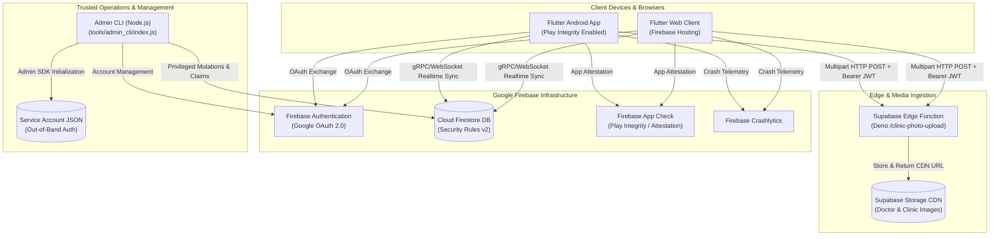
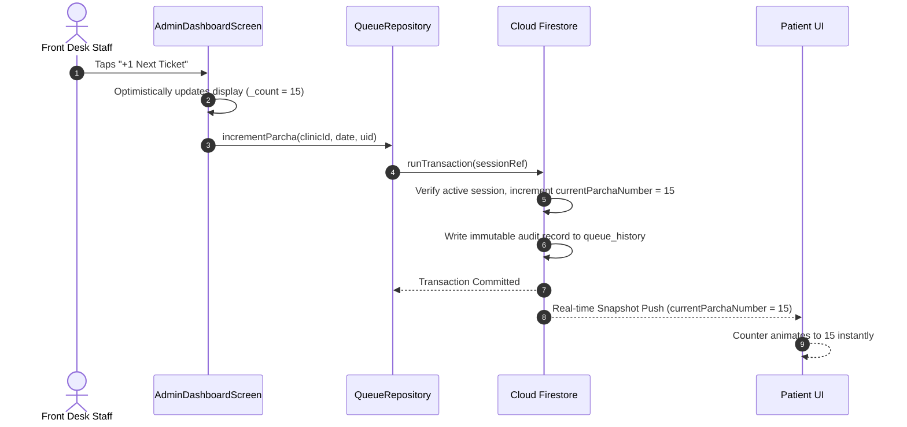

# ARCHITECTURE.md — EasyCheck Online System Architecture

> **Application:** EasyCheck Online (`easycheck-online`)  
> **Type:** Real-Time Outpatient & Clinic Queue Tracking System  
> **Platform:** Flutter Cross-Platform (Android & Web) + Firebase Cloud Services  
> **Status:** Production-Ready Architectural Specification  
> **Last Updated:** 2026-11-12  

---

## 1. High-Level System Architecture

EasyCheck Online operates on a **Direct-to-Firestore Reactive Client Architecture**. The Flutter application connects directly to Google Cloud Firestore using real-time document snapshot listeners over gRPC / WebSockets, eliminating the need for a traditional custom backend server layer for standard client CRUD operations.

Privileged administrative actions and platform-level lifecycle changes are handled by a dedicated, trusted Node.js CLI tool powered by the Firebase Admin SDK.



---

## 2. Client Application Architecture (Flutter)

The mobile and web clients are built using Flutter and Dart (v3.13+) following a **Feature-First Layered Architecture**.

```
lib/
├── app/                  # Application-wide configuration and bootstrap
│   ├── app.dart          # MaterialApp setup, Route table, Theme injection
│   ├── localization/     # Bilingual support (en/hi) & LocaleController
│   ├── routes/           # AppRoutes definitions and route arguments
│   └── theme/            # Dual-theme design tokens (Clinical Clarity vs Clinical Precision)
├── core/                 # Shared foundational elements
│   ├── constants/        # Assets, typography, and layout spacing tokens
│   ├── errors/           # AppFailure hierarchy (Server, Unauthorized, Connection)
│   └── widgets/          # Shared components (BrandMark, LiveDot, PhotoCropDialog, AppSnackBar)
├── features/             # Domain-driven feature modules
│   ├── admin/            # Clinic staff dashboards, queue tally management, studio tools
│   ├── authentication/   # Login screens, AuthGate, GoogleAuthService, Access request flows
│   ├── clinic/           # Patient clinic details view
│   ├── clinics/          # Clinic, Membership, and Queue repositories & entities
│   ├── legal/            # Terms of Service, Privacy Policy, and About pages
│   └── patient/          # Patient discovery home, search filter, live counters
└── main.dart             # App initialization (Firebase, App Check, Crashlytics)
```

### 2.1 Dual Design System Implementation
To maintain clear psychological and operational boundaries between roles, EasyCheck Online uses two distinct design systems:
1. **Clinical Clarity (Patient Experience):**
   - **Primary Surface:** `#F8F9FF` (Calm clinical canvas)
   - **Primary Accent:** `#002553` (Deep Navy) & `#006D44` (Emerald Green)
   - **Focus:** Legibility, low anxiety, high contrast for outdoor sunlight reading, and instant ticket visibility.
2. **Clinical Precision (Staff / Admin Experience):**
   - **Primary Surface:** High-density operational layout
   - **Primary Accent:** `#006A42` (Medical Green) with high-contrast alert states
   - **Focus:** Fast physical thumb interaction (large increment targets), optimistic queue updating, and immediate tactile feedback.

---

## 3. Communication & Data Synchronization Protocols

### 3.1 Real-Time Snapshot Sync (Firestore Streams)
EasyCheck does not poll for queue changes. Both patient discovery and clinic dashboards subscribe to reactive Firestore streams:
- `QueueRepository.sessionStream(clinicId, date)`: Emits real-time updates for today's active ticket counter.
- `ClinicRepository.clinicStream(clinicId)`: Emits changes to doctor availability (`available`, `delayed`, `offDuty`), clinic online state, and OPD timings.
- `ClinicRepository.clinicsStream()`: Emits active and offline clinics for patient discovery.

### 3.2 Optimistic Concurrency & Background Reconciliation
To prevent UI lag during busy clinic hours, `AdminDashboardScreen` implements an **optimistic queuing counter**:
1. When staff taps `+1`, the UI counter updates immediately on screen (`_count += 1`).
2. The mutation is added to an internal synchronization queue (`_pendingCounterDelta += 1`).
3. An unawaited worker (`_drainCounterQueue()`) flushes increments to Firestore inside ACID transactions (`runTransaction`).
4. If a network drop occurs, the UI reconciles with the last known server value upon reconnection.



---

## 4. Media Ingestion & Edge Function Pipeline

Doctor portraits and clinic cover images are processed outside Firestore to prevent document bloat and keep read costs low:
1. **Selection & Cropping:** The user picks an image using `image_picker`. The custom `PhotoCropDialog` provides real-time canvas pan/zoom cropping (1:1 for doctor portraits, 16:9 for clinic banners).
2. **Authentication:** The client fetches the current user's Firebase Auth ID token (`user.getIdToken()`).
3. **Edge Processing:** A multipart POST is dispatched to `https://oeyetcapghqibcqkcued.supabase.co/functions/v1/clinic-photo-upload` with `Authorization: Bearer <ID_TOKEN>`.
4. **Validation:** The Supabase Edge function verifies the Firebase token signature, validates file size (under 5 MB), checks clinic active status, and uploads to an optimized CDN storage bucket.
5. **Persistence:** The returned CDN URL is written to `clinics/{clinicId}` in Firestore.

---

## 5. Security & Isolation Architecture

### 5.1 Defense-in-Depth Layers

```
Layer 1: Device Attestation
└── Firebase App Check (Play Integrity on Android; DeviceCheck on iOS)
    └── Blocks automated scripts, emulators, and unverified APKs from accessing Firebase.

Layer 2: Identity & Authentication
└── Google OAuth 2.0 federated through Firebase Authentication
    └── Cryptographically signed JWT tokens with 1-hour expiration.

Layer 3: Authorization Gate (Client-Side)
└── AuthGateScreen -> AdminAccessService.resolveUid(uid)
    └── Server-verified lookup against clinic_members before opening any admin screen.

Layer 4: Database Access Enforcement (Server-Side)
└── Cloud Firestore Security Rules v2
    └── Request-level rule evaluation (isSuperAdmin, isClinicAdmin, isActiveMember, canManageClinic).

Layer 5: Audit Logging
└── Immutable append-only audit collections:
    ├── queue_history (every queue tally mutation with operator UID)
    └── admin_audit_log (every administrative CLI mutation)
```

---

## 6. Architectural Decision Records (ADRs)

| ADR ID | Decision | Rationale | Alternatives Considered |
| :--- | :--- | :--- | :--- |
| **ADR-01** | Direct-to-Firestore Architecture | Maximizes real-time performance, reduces operational complexity, and eliminates custom backend API maintenance. | Node.js / Express REST API, NestJS GraphQL API. |
| **ADR-02** | Supabase Edge Storage for Photos | Keeps Firestore documents lightweight and avoids complex Firebase Storage rules for binary payloads. | Firebase Storage, Cloudinary, AWS S3. |
| **ADR-03** | Out-of-Band Admin CLI | Prevents exposure of super-admin capabilities in public client code; enforces dual-operator security. | Web-based Super Admin portal, Cloud Functions HTTP endpoints. |
| **ADR-04** | Dual Persona Dynamic Gate | Single unified mobile application for both patients and doctors, dynamically gated by Firestore role resolution. | Two separate APKs/repositories. |
