 <div align="center">


# EasyCheck ONLINE

### Real-time Clinic Availability & Live Parcha Tracking

**A Flutter-based clinic discovery and queue visibility application.**

[](https://flutter.dev/)
[](https://dart.dev/)
[](https://firebase.google.com/)
[](https://supabase.com/)
[](https://www.android.com/)

</div>

---

## 📑 Contents

- [Overview](#-overview)
- [The Problem](#-the-problem)
- [Features](#-features)
- [Screenshots](#-screenshots)
- [Technology Stack](#-technology-stack)
- [System Architecture](#-system-architecture)
- [Authentication Flow](#-authentication-and-access-flow)
- [Firestore Data Model](#-firestore-data-model)
- [Doctor Photo Upload](#-doctor-photo-upload-flow)
- [Queue Synchronization](#-queue-and-live-synchronization)
- [Project Structure](#-repository-structure)
- [Installation](#-local-development-setup)
- [Firebase & Supabase Configuration](#-firebase-and-supabase-configuration)
- [Admin CLI](#-trusted-admin-cli)
- [Security](#-security-model)
- [Testing](#-testing-and-verification)
- [Limitations](#-current-limitations-and-pending-work)
- [Deployment](#-deployment-notes)
- [Contributing](#-contributing)
- [License](#-license)

## 🩺 Overview

EasyCheck ONLINE is designed to help patients check clinic information, doctor availability and the current daily parcha/queue count before visiting a clinic.

Clinic staff can manage the clinic's operational status and update the queue. The patient-facing app receives updates from Cloud Firestore in real time.

The current repository is primarily a **Flutter Android application**. It also contains Firebase Hosting configuration for a Flutter Web build, Firebase security/configuration files, and a trusted local Node.js CLI for privileged clinic administration.

> **Architecture clarification:** Firebase is the primary application backend. Supabase is used for the doctor-photo upload/storage path through a Supabase Edge Function. The repository does not contain a separate implemented Super Admin web dashboard.

## 🎯 The Problem

Traditional clinic visits can involve uncertainty:

- Patients may not know whether the doctor is available.
- Patients may reach the clinic without knowing how many parchas have already been issued.
- Clinic staff need a simple way to update queue progress.
- Patients need timely queue information without repeatedly calling the clinic.

EasyCheck ONLINE aims to make this information visible before the patient travels.

## ✨ Features

### Patient Experience

- Google sign-in using Firebase Authentication.
- Patient / Doctor-Staff role selection.
- Clinic discovery from Firestore.
- Clinic detail view with doctor name, qualifications/specialty and profile photo where available.
- Current and previous-day parcha count fields.
- Doctor availability and clinic online/offline status.
- Live updates from Firestore streams.
- Privacy, terms and account-deletion screens.

### Clinic Staff Experience

- Google sign-in for clinic staff.
- Clinic access request flow.
- Pending, approved, rejected and unauthorized access states.
- Clinic dashboard for permitted clinic members.
- Queue increment/decrement and reset controls.
- Clinic online/offline status.
- Doctor status and OPD timing information.
- Doctor photo update flow.
- Access is scoped to the clinic membership provisioned for the signed-in user.

### Trusted Operations

The repository includes a local Admin SDK CLI for privileged operations:

- List access requests.
- Approve or reject clinic access requests.
- Create clinics and their first admin membership.
- Add or update clinic members.
- Remove/offboard a clinic member.
- Deactivate a clinic.
- Inspect clinics, members and users.
- Write administrative audit records.

The CLI is a trusted operator tool. It is not part of the mobile application.

### Feature Implementation Inventory

The following charts count Dart source files in the corresponding `lib/features/` folders in this repository. These are **code-file counts, not feature-completion or usage statistics**.

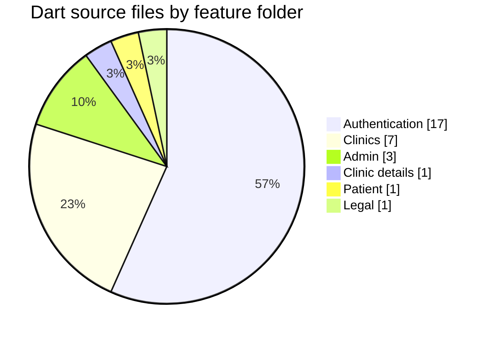

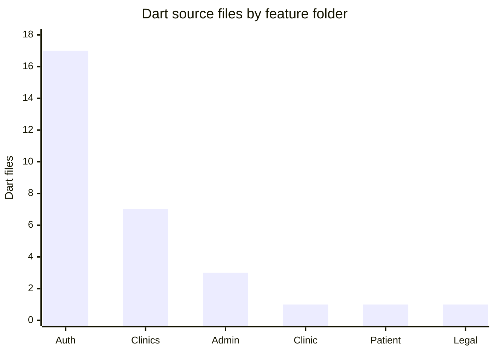

## 📱 Screenshots

Screenshots below are the Stitch design references included in this repository. They show the intended interface direction and should not be interpreted as proof that every screen is currently deployed.

### Patient App

| Patient Home | Clinic Details | Google Login |
|---|---|---|
| 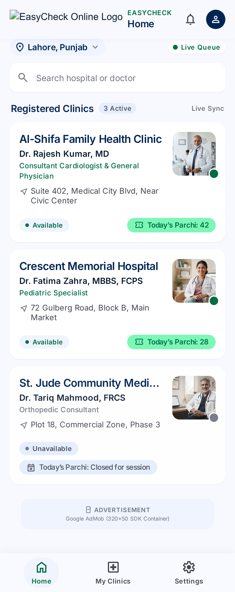 | 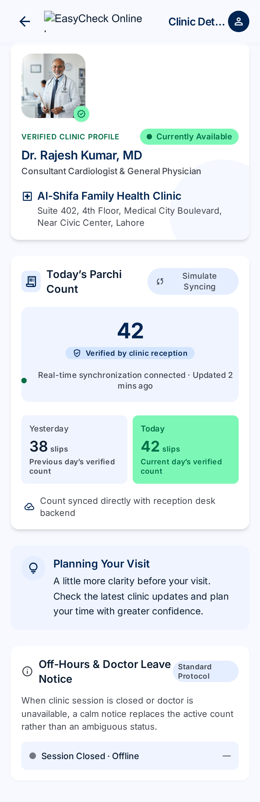 | 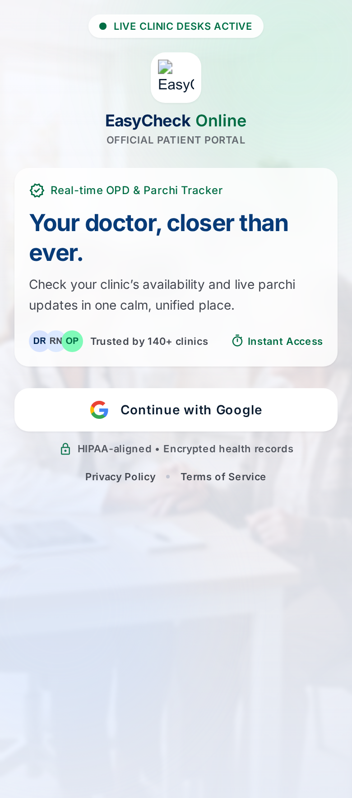 |

### Clinic Admin App

| Admin Dashboard | Google Authentication | Reset Confirmation |
|---|---|---|
| 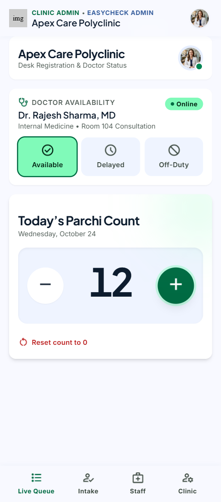 | 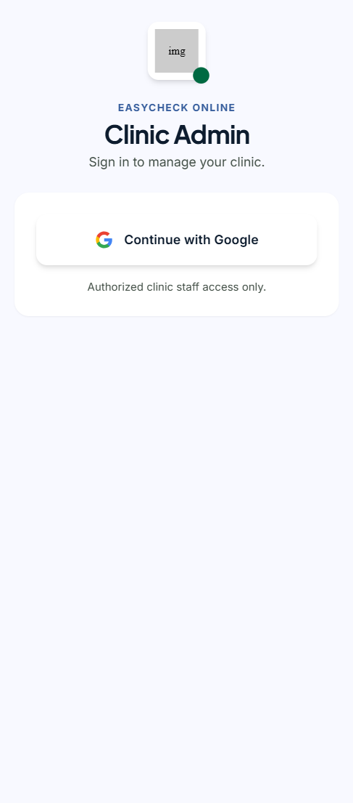 | 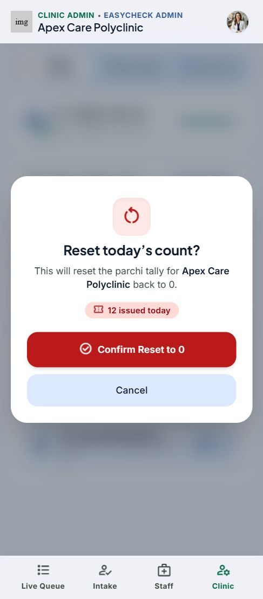 |

### Branding Assets

| Patient Brand | Admin Brand | App Icon |
|---|---|---|
|  |  |  |

## 🧰 Technology Stack

The stack below is based on the source files and dependency manifest in this repository.

| Technology | Logo | Usage |
|---|---|---|
| Flutter |  | Cross-platform UI framework; current app targets Android and includes Flutter Web hosting configuration |
| Dart |  | Application language |
| Firebase Authentication |  | Google sign-in and authenticated user sessions |
| Cloud Firestore |  | Clinic profiles, memberships, access requests, queue sessions and history |
| Firebase App Check |  | App attestation initialization |
| Firebase Crashlytics |  | Flutter fatal-error reporting |
| Supabase Storage + Edge Function |  | Doctor-photo upload endpoint and photo storage |
| Node.js |  | Trusted local admin CLI runtime |
| Firebase Admin SDK |  | Privileged CLI operations outside the client app |
| Google Sign-In |  | User identity provider |
| Inter / Plus Jakarta Sans | — | Included app typography assets |

### Main Flutter Packages

| Package | Purpose |
|---|---|
| `firebase_core` | Firebase initialization |
| `firebase_auth` | Firebase Authentication |
| `cloud_firestore` | Firestore reads, writes, transactions and streams |
| `google_sign_in` | Native Google account sign-in |
| `firebase_app_check` | App Check client initialization |
| `firebase_crashlytics` | Crash reporting |
| `image_picker` | Select doctor image from device |
| `http` | Multipart request to the Supabase Edge Function |
| `cached_network_image` | Network image loading and caching |
| `flutter_svg` | SVG asset rendering |
| `intl` | Date/time and formatting support |

Versions are maintained in [`pubspec.yaml`](pubspec.yaml).

## 🏗 System Architecture

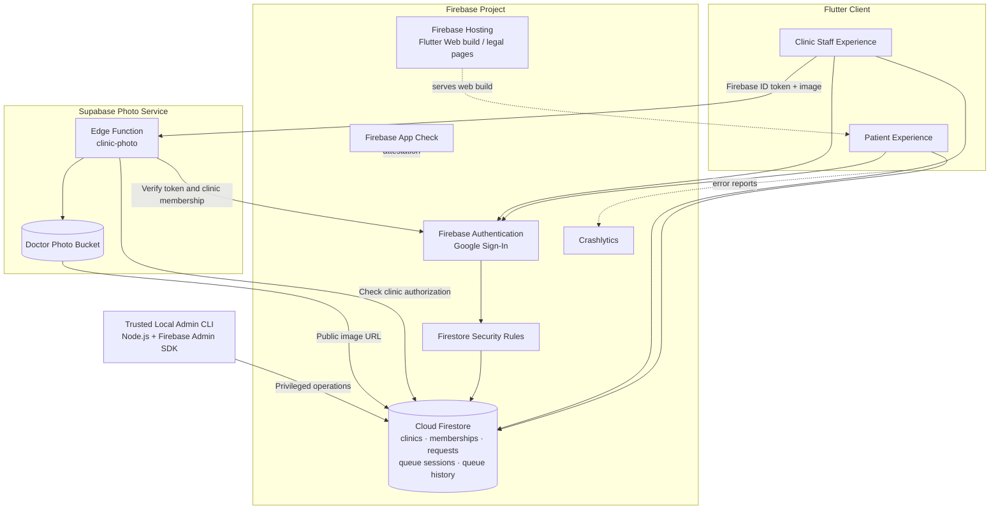

### Responsibility Split

| Layer | Responsibility |
|---|---|
| Flutter app | Patient and clinic-staff interface |
| Firebase Authentication | User identity and Google sign-in |
| Cloud Firestore | Operational application data |
| Firestore Security Rules | Client-side data access authorization |
| Firebase App Check | App attestation integration |
| Crashlytics | Fatal crash/error reporting |
| Supabase Edge Function | Authenticated doctor-photo upload gateway |
| Supabase Storage | Doctor-photo object storage |
| Trusted Admin CLI | Privileged clinic, request and membership operations |
| Firebase Hosting | Hosting configuration for web output and legal pages |

## 🔐 Authentication and Access Flow

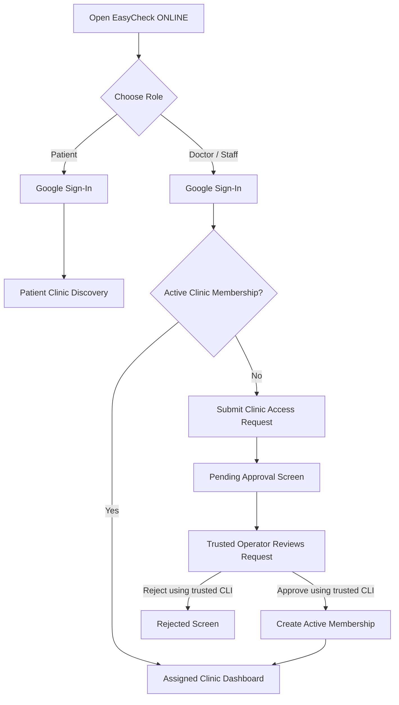

**Important current-state note:** The Flutter request and pending/rejected states exist, and the trusted CLI can approve/reject and provision membership. A Super Admin web dashboard or hosted approval API is not included in this repository. The approval operation currently requires trusted CLI access.

### Authorization Rules

- A signed-in user does not automatically become a clinic admin.
- Client-written role fields do not grant clinic access.
- Clinic admin access requires an active `clinic_members` record.
- Membership documents cannot be created or changed by ordinary clients.
- Applicants can create only their own pending access request.
- Approval/rejection is reserved for trusted Admin SDK operations.
- Queue and clinic operations are checked against the member's clinic.

## 🗃 Firestore Data Model

The main collections referenced by the application and security rules are:

| Collection | Purpose | Document ID Pattern |
|---|---|---|
| `users` | User profile | `{firebaseAuthUid}` |
| `clinics` | Public clinic and doctor display information | `CLN-XXXXX` |
| `clinic_members` | Clinic-specific staff membership and role | `{uid}_{clinicId}` |
| `admin_access_requests` | Staff requests awaiting trusted review | `{uid}_{clinicId}` |
| `queue_sessions` | Current daily queue state | `{clinicId}_{YYYY-MM-DD}` |
| `queue_history` | Append-only parcha activity history | Generated document ID |
| `admin_audit_log` | Trusted administrative action history | Generated document ID |

### Entity Relationship Overview

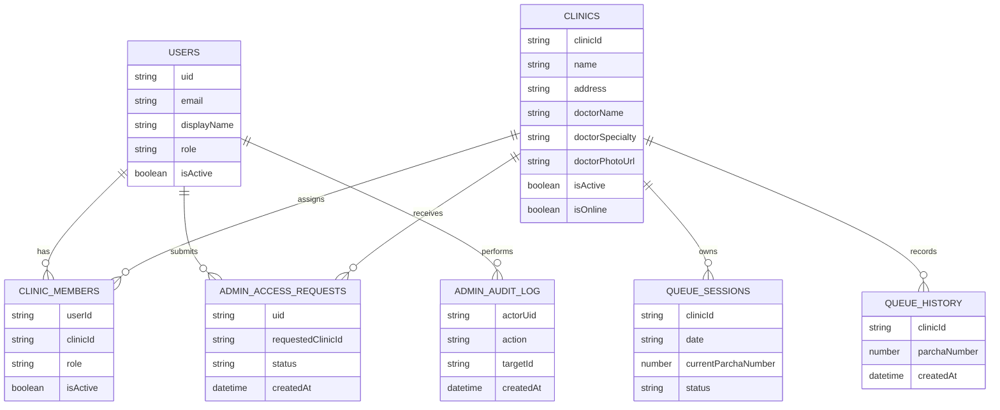

The exact fields and rule conditions are defined in [`firestore.rules`](firestore.rules), the model/repository classes under [`lib/features/`](lib/features/), and the phase documentation under [`project_docs/`](project_docs/).

## 🖼 Doctor Photo Upload Flow

The current source uses **Supabase Storage through a Supabase Edge Function**, not the Firebase Storage SDK.

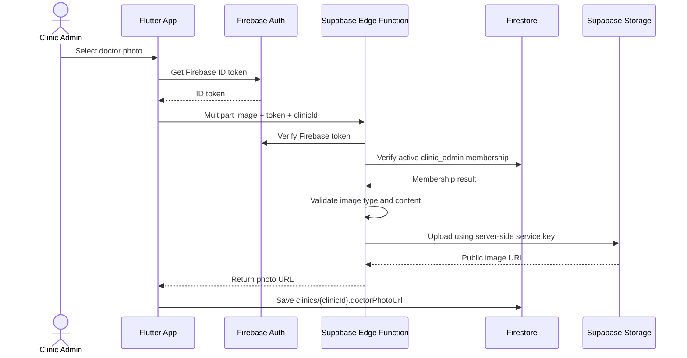

### Current Upload Behavior Found in Source

- Client obtains a Firebase ID token.
- Client sends the token, clinic ID and image as a multipart request.
- The Edge Function is expected to verify the Firebase identity and clinic membership.
- The Supabase service-role key is intended to remain server-side.
- The returned public URL is saved to `clinics/{clinicId}.doctorPhotoUrl`.
- Client-side maximum currently defined in `ClinicPhotoService`: **5 MiB**.

> **Important configuration mismatch to review:** The repository's Task 24 hardening document describes a Firebase Storage upload implementation and a `storage.rules` file, but the Dart source in this ZIP currently calls the Supabase Edge Function and enforces a 5 MiB client limit. No `storage.rules` or Supabase Edge Function source is present in this ZIP. Confirm the deployed Edge Function and bucket configuration before treating the photo path as fully reproducible from this repository. If the product requirement is a strict limit below 2 MB, update and test both client and server validation; this code currently does not implement that limit.

## ⚡ Queue and Live Synchronization

The queue is organized by clinic and local date.

- A daily session uses the ID pattern `{clinicId}_{YYYY-MM-DD}`.
- The session stores `currentParchaNumber` and status.
- Increment operations use a Firestore transaction to avoid conflicting counter updates.
- Queue changes are streamed to patient screens.
- Historical parcha events are written to `queue_history`.
- A paused/non-active queue session rejects increment operations.

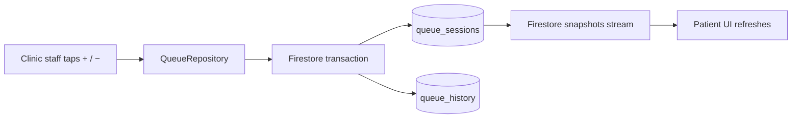

## 📂 Repository Structure

```text
.
├── android/                         # Android application and Gradle configuration
├── assets/
│   ├── fonts/                       # Inter and Plus Jakarta Sans
│   ├── icons/                       # SVG assets
│   └── images/                      # Branding, doctor and UI images
├── firebase.json                    # Firebase Hosting and header configuration
├── firestore.rules                  # Firestore authorization rules
├── firestore.indexes.json           # Firestore index configuration
├── lib/
│   ├── app/
│   │   ├── localization/             # App localization
│   │   ├── routes/                   # Route definitions
│   │   └── theme/                    # Colors, spacing, typography and themes
│   ├── core/
│   │   ├── config/                   # Service configuration
│   │   ├── constants/                # App constants and asset paths
│   │   ├── errors/                   # Error and failure types
│   │   ├── utils/                    # Shared utilities
│   │   └── widgets/                  # Shared UI components
│   ├── features/
│   │   ├── admin/                    # Clinic staff dashboard and controls
│   │   ├── authentication/           # Google auth, roles and access requests
│   │   ├── clinic/                   # Clinic details
│   │   ├── clinics/                  # Models, repositories, queue and photos
│   │   ├── legal/                    # Legal and account pages
│   │   └── patient/                  # Patient home
│   ├── shared/                       # Shared models and widgets
│   ├── firebase_options.dart         # Generated Firebase client options
│   └── main.dart                     # Application entry point
├── project_docs/                     # Phase, architecture, audit and test reports
├── stitch_easycheck_clinic_admin/    # Clinic admin Stitch design references
├── stitch_easycheck_clinic_mobile_ui/# Patient Stitch design references
├── store_assets/                     # Play Store graphics and screenshots
├── test/                             # Flutter unit/widget tests
├── tools/admin_cli/                  # Trusted local Firebase Admin SDK CLI
├── web/                              # Flutter Web shell and icons
├── .env.example                      # Environment variable template (review usage)
└── pubspec.yaml                      # Flutter dependencies and assets
```

## 💻 Local Development Setup

### Prerequisites

Install the following:

- Flutter SDK compatible with the Dart SDK constraint in `pubspec.yaml`.
- Dart SDK (bundled with Flutter).
- Android Studio or VS Code.
- Android SDK and an Android emulator or physical Android device.
- Git.
- Node.js and npm only if you need the trusted admin CLI.

Check your installation:

```bash
flutter --version
dart --version
flutter doctor
```

### Clone the Repository

```bash
git clone https://github.com/bipulkumar62/Easycheck-ONLINE.git
cd Easycheck-ONLINE
```

### Install Flutter Dependencies

```bash
flutter pub get
```

### Run Static Analysis and Tests

```bash
flutter analyze
flutter test
```

### Run on a Connected Device

```bash
flutter devices
flutter run
```

### Build Android APK

```bash
flutter build apk --release
```

### Build Android App Bundle

```bash
flutter build appbundle --release
```

### Build Flutter Web

```bash
flutter build web --release
```

The repository contains Firebase Hosting configuration. Deploy only after checking the target Firebase project and reviewing the hosting configuration:

```bash
firebase deploy --only hosting
```

## 🔧 Firebase and Supabase Configuration

### Firebase

The app initializes Firebase using `lib/firebase_options.dart`. Firebase client configuration values are embedded in client applications by design; they are identifiers, **not authorization secrets**. Real protection comes from Authentication, Firestore Security Rules, App Check enforcement and trusted backend operations.

Before running against a Firebase project:

1. Create or select the intended Firebase project.
2. Register the Android app with the package ID from the Android Gradle configuration.
3. Enable Google as an Authentication provider.
4. Configure the Android SHA fingerprints for the signing keys you use.
5. Confirm Firestore region, database and required indexes.
6. Review and deploy `firestore.rules`.
7. Configure App Check providers and only enable enforcement after valid debug/release app registrations are confirmed.
8. Confirm Crashlytics is enabled if crash reporting is required.

Do not replace the existing project configuration blindly. Use the matching Firebase project and app registrations.

### Supabase

The Supabase project URL is referenced by `lib/core/config/supabase_config.dart`. The mobile client calls the `clinic-photo` Edge Function endpoint.

The following must be configured in the Supabase project outside this repository:

- A Storage bucket for doctor photos.
- The `clinic-photo` Edge Function.
- Server-side Supabase service-role secret stored as an Edge Function secret.
- Firebase token verification logic in the Edge Function.
- Firestore membership verification for the requested clinic.
- Server-side image content/type/size validation.
- Appropriate public-read or signed-URL policy for doctor photos.

**Never put the Supabase service-role key in Flutter code, `.env` files bundled with the app, GitHub, or a browser.** A public project URL is not a substitute for authorization.

### Environment File Note

`.env.example` is present in the repository, but the current `pubspec.yaml` does not include `flutter_dotenv`, and the inspected app startup does not load a `.env` file. Do not assume those template values are consumed by the Flutter application. Use the actual configuration mechanism documented by the source code.

## 🛠 Trusted Admin CLI

The local operator CLI lives in `tools/admin_cli/` and uses `firebase-admin`.

```powershell
cd tools/admin_cli
npm install
$env:GOOGLE_APPLICATION_CREDENTIALS = "C:\secure-path\firebase-service-account.json"
```

Keep the service-account JSON outside the repository. It has privileged access and can bypass Firestore Security Rules.

Examples:

```powershell
# List pending access requests
node index.js list-requests --status pending

# Approve a request
node index.js approve "<requestId>" --by "<operatorUid>" --role clinic_admin --reason "Verified clinic ownership"

# Reject a request
node index.js reject "<requestId>" --by "<operatorUid>" --reason "Clinic details could not be verified"

# List clinics
node index.js list-clinics

# List members for a clinic
node index.js list-members --clinic CLN-XXXXX
```

See [`tools/admin_cli/README.md`](tools/admin_cli/README.md) for the full command list and safety behavior.

## 🛡 Security Model

Security controls present in the source/configuration and project reports include:

- Google sign-in through Firebase Authentication.
- Firestore rules that deny client-created clinic memberships.
- Patient self-profile rules that prevent self-elevation to clinic admin.
- Clinic-scoped membership authorization.
- Access requests restricted to the signed-in applicant.
- Queue writes restricted to authorized clinic members.
- Trusted Admin SDK CLI for privileged membership and approval operations.
- Supabase upload endpoint designed to verify Firebase ID tokens and clinic membership before writing images.
- App Check client initialization (debug provider for debug builds and Play Integrity for Android release builds).
- Crashlytics fatal error reporting.
- Android backup and cleartext traffic settings documented in production hardening notes.
- Firebase Hosting security headers configured in `firebase.json`.

### Security Is Not a Claim of Invulnerability

- App Check is not a replacement for authentication or Security Rules.
- Firebase client configuration is public by design.
- A service-account key or Supabase service-role key must never be distributed to clients.
- Supabase Edge Function implementation and deployed Storage policy are not included in this ZIP and require independent review.
- The current photo client limit is 5 MiB, not below 2 MB.
- The repository does not include a Super Admin web application or hosted approval backend.

## 🧪 Testing and Verification

The ZIP includes Flutter tests under `test/`, including:

- Widget tests.
- Clinic model tests.
- Clinic photo service tests.
- Admin access service tests.
- Responsive overflow tests.

The included phase reports record the following verification at different project stages:

| Report | Recorded Result |
|---|---|
| Task 22 end-to-end report | Earlier integration-stage widget tests and APK build passed; real-time queue flow and rules probes documented |
| Task 23 test report (Nov 5, 2026) | `flutter analyze` passed; 38/38 tests passed; debug/release APK, AAB and web builds recorded; Google consent and Super Admin approval remained manual/blocked |
| Task 24 production hardening report (Nov 2026) | Reports 64/64 tests passed, `flutter analyze` passed and debug APK build succeeded; Firebase Storage enablement and real-device/operator steps remained pending |

These are **historical results copied from the repository's phase reports**, not a fresh test run performed while generating this README. Run the commands locally against the current checkout before release.

## 🚧 Current Limitations and Pending Work

The following points are explicitly documented in the supplied project files:

1. **No Super Admin web dashboard:** privileged operations are currently handled by the trusted local CLI.
2. **No hosted approval backend:** applicants can submit requests, but approval/rejection currently requires trusted CLI operations.
3. **Initial clinic membership provisioning:** the first admin membership must be provisioned by a trusted operator.
4. **Google sign-in consent:** the Task 23 report says a real Google account consent flow still needs manual verification.
5. **Supabase Edge Function source is absent:** the Flutter client calls the function, but its server implementation is not in this ZIP.
6. **Storage configuration mismatch:** Task 24 documentation mentions Firebase Storage work, while current Dart source uses Supabase for doctor photos. Confirm which backend is deployed and make code/docs consistent.
7. **Photo size limit:** current client code allows up to 5 MiB. It does not satisfy a less-than-2-MB requirement.
8. **App Check enforcement:** project notes say enforcement should remain off until debug tokens and release signing fingerprints are configured and tested.
9. **Physical-device verification:** the phase report calls for a real-device test.
10. **Play Store release:** the project notes list Play Console listing, data safety, reviewer access and signing fingerprint steps as operator work.
11. **Push notifications:** not implemented in the documented hardening pass; the notes explicitly say the in-app notification UI is not a working FCM delivery system.
12. **Automated subscription reminders:** no verified implementation is included in this repository snapshot.

## 🚀 Deployment Notes

### Firebase Hosting

The repository's `firebase.json` includes Hosting configuration and security headers. The project documentation records the deployed site:

- `https://easycheck-online.web.app`

Check the Firebase project alias in `.firebaserc` before deploying. A deployment can overwrite the currently hosted app.

```bash
flutter build web --release
firebase deploy --only hosting
```

### Android Release

Before publishing:

1. Update the app version/build number in `pubspec.yaml`.
2. Confirm the release signing configuration.
3. Add the correct Play App Signing SHA-1/SHA-256 fingerprints to Firebase.
4. Re-test Google sign-in using the Play-distributed build.
5. Complete Play Console privacy, data safety, content rating and app access requirements.
6. Test on a physical Android device.
7. Confirm App Check behavior before enforcing it.

Follow `project_docs/phase_24_production_hardening/PRODUCTION_HARDENING.md` for operator steps. Never commit signing keys or service-account credentials.

## 🤝 Contributing

1. Create a feature branch.
2. Read the repository change-safety and architecture documents before editing:
   - [`ARCHITECTURE.md`](ARCHITECTURE.md)
   - [`SYSTEM-DESIGN.md`](SYSTEM-DESIGN.md)
   - [`SAFE-CHANGE-RULES.md`](SAFE-CHANGE-RULES.md)
   - [`CHANGE-SCOPE.md`](CHANGE-SCOPE.md)
   - [`IMPACT-MAP.md`](IMPACT-MAP.md)
   - [`COLD-PATHS.md`](COLD-PATHS.md)
   - [`ENV-CONTRACTS.md`](ENV-CONTRACTS.md)
   - [`STALE-SESSION.md`](STALE-SESSION.md)
   - [`MULTI-TAB-CONFLICT.md`](MULTI-TAB-CONFLICT.md)
   - [`SOFT-DELETE-CONSISTENCY.md`](SOFT-DELETE-CONSISTENCY.md)
3. Keep clinic authorization enforced by Firestore rules and trusted backend code.
4. Do not add secrets or privileged keys to client code.
5. Run:

   ```bash
   dart format .
   flutter analyze
   flutter test
   ```

6. Document changes and known limitations in the relevant `project_docs/` phase.

## 📄 License

No license file was present in the supplied repository snapshot. Unless a license is added, do not assume the project is open source or that reuse, redistribution or modification is permitted.

---

<div align="center">

**EasyCheck ONLINE**

*Less uncertainty before the clinic visit.*

</div>
