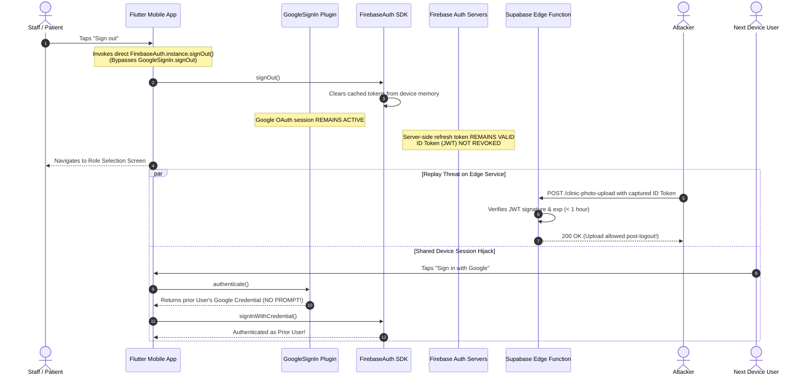
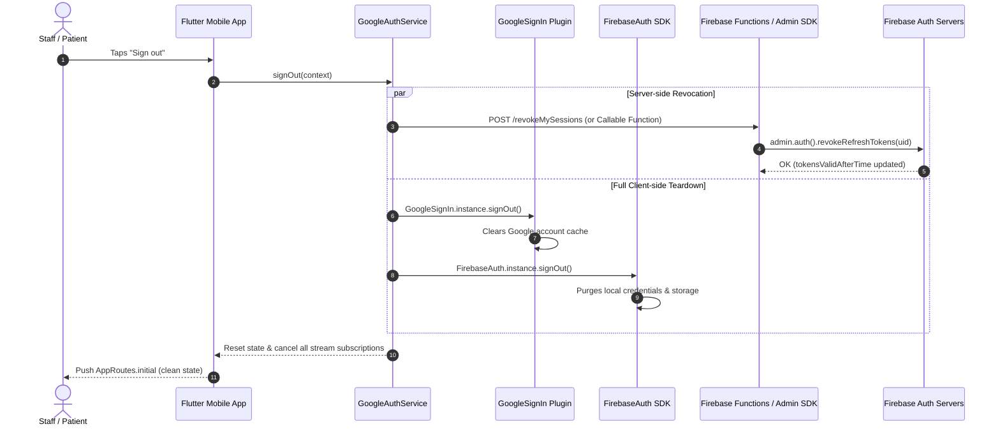

# STALE-SESSION.md — Session Invalidation & Logout Security Audit

> **Target Project:** EasyCheck Online (`easycheck-online`)  
> **Auditor Role:** Senior Application Security Engineer & Cloud Security Architect  
> **Audit Status:** Complete — Read-Only Forensic Assessment  
> **Document Version:** 1.0.0  
> **Audit Date:** 2026-11-09  

---

## 1. Executive Summary & Audit Scope

This document provides a comprehensive security audit of session lifecycle management, token revocation mechanisms, client-side logout implementations, and administrative deactivation workflows across **EasyCheck Online**.

EasyCheck Online is a dual-persona clinic queue and real-time tally tracking system built with **Flutter (Mobile/Web)**, **Google Identity Services (OAuth 2.0)**, **Firebase Authentication**, **Cloud Firestore (Security Rules v2)**, **Firebase App Check**, and a **Supabase Edge Function** (`clinic-photo-upload`).

### High-Level Audit Findings

| Category | Finding Summary | Severity | Status |
| :--- | :--- | :---: | :---: |
| **Client Logout Hygiene** | 9 out of 10 logout call sites invoke `FirebaseAuth.instance.signOut()` directly without clearing `GoogleSignIn.instance`, leaving the underlying Google OAuth session active on shared mobile devices. | **High** | Verified |
| **Server-Side Session Revocation** | Logout operates strictly client-side. No Firebase Admin SDK token revocation (`auth.revokeRefreshTokens`) or session invalidation endpoint exists; issued Firebase ID tokens remain valid until expiration (up to 3600s). | **High** | Verified |
| **Third-Party Service Exposure** | Supabase Edge Function (`/clinic-photo-upload`) relies on raw Bearer ID tokens without token-revocation verification, allowing replayed token usage post-logout. | **Medium** | Verified |
| **Administrative Deactivation** | The operator CLI (`tools/admin_cli/index.js`) deactivates clinic memberships in Firestore (`isActive: false`) but does not revoke refresh tokens or disable accounts in Firebase Auth. | **High** | Verified |
| **In-Memory UI Session Guard** | While `AdminDashboardScreen` listens to `clinicStream` for clinic status changes, it lacks a real-time listener on the user's `clinic_members` document, leaving de-authorized staff on privileged UI views until interaction triggers a rule failure. | **Medium** | Verified |
| **Multi-Device Revocation** | No "Sign out from all devices" feature exists. Logging out from one device leaves active refresh tokens and sessions intact on all other physical devices. | **Medium** | Verified |

---

## 2. Authentication & Session Architecture

### 2.1 Identity & Session Mechanics

EasyCheck Online does not employ traditional stateful server sessions, HTTP session cookies, or Redis session stores. The application runs on a federated, token-based hybrid architecture:

```
+---------------------------------------------------------------------------------------+
|                                    Client Device                                      |
|                                                                                       |
|   +-----------------------+     OAuth 2.0      +----------------------------------+   |
|   | GoogleSignIn (Plugin) | -----------------> | Google Identity Services (OAuth) |   |
|   +-----------------------+                    +----------------------------------+   |
|              | Google Auth Credentials                           |                    |
|              v                                                   v                    |
|   +-----------------------+  Exchange Credential   +------------------------------+   |
|   | FirebaseAuth (Client) | <--------------------> | Firebase Auth Backend (JWT)  |   |
|   +-----------------------+                        +------------------------------+   |
|         |           |                                       |                         |
|   Refresh Token   ID Token (JWT)                            |                         |
|   (Secure Storage)  | (Memory, exp: 1hr)                    |                         |
+---------|-----------|---------------------------------------|-------------------------+
          |           |                                       |
          |           +--------------+------------------------+
          |                          |
          v                          v
+--------------------+     +------------------------------------------------------------+
| Firebase Cloud     |     | Authorization & Backend Gateways                           |
| Auth Token Server  |     |                                                            |
| (Rotates / Issues) |     | 1. Cloud Firestore Rules (evaluates request.auth / claims) |
+--------------------+     | 2. Supabase Edge Function (verifies Bearer JWT signature)  |
                           +------------------------------------------------------------+
```

1. **Client Identity Layer:** Authenticates via Google Sign-In (`google_sign_in: ^6.2.2`).
2. **Token Exchange Layer:** Passes `GoogleAuthProvider.credential` to `FirebaseAuth.instance.signInWithCredential`.
3. **Primary Session Credentials:**
   - **Firebase ID Token (JWT):** Short-lived access token (3,600 seconds / 1 hour) signed by `https://securetoken.google.com/easycheck-online`. Contains `sub` (UID), `email`, `iat`, `exp`, `auth_time`, and custom claims (`superAdmin`).
   - **Firebase Refresh Token:** Long-lived credential held in local mobile secure storage (`SharedPreferences` on Android backed by KeyStore; `Keychain` on iOS). Exchanged by the client SDK automatically to acquire new ID tokens.
4. **Authorization Layer:**
   - **Firestore Security Rules:** Validates `request.auth.uid`, `request.auth.token.superAdmin`, and document lookups (`clinic_members/{uid}_{clinicId}`).
   - **Supabase Edge Function:** Inspects the incoming `Authorization: Bearer <idToken>` header at `https://oeyetcapghqibcqkcued.supabase.co/functions/v1/clinic-photo-upload`.

---

## 3. Audit Matrix: 12 Key Security Vectors

The following matrix documents every security risk assessed during the forensic audit, backed by concrete repository evidence.

| # | Security Risk Vector | Finding | Severity | Evidence / File Citation | Root Cause & Impact |
| :-: | :--- | :---: | :---: | :--- | :--- |
| **1** | **Access tokens remain usable after logout** | **VULNERABLE** | **HIGH** | `lib/features/authentication/google_auth_service.dart:127-140`<br>`lib/features/admin/admin_dashboard_screen.dart:683-694` | `FirebaseAuth.signOut()` deletes tokens locally from device memory, but the stateless Firebase ID token remains cryptographically valid until its 1-hour expiration timestamp. If intercepted or retained by an edge proxy, it can execute requests until expiration. |
| **2** | **Refresh tokens can generate new access tokens after logout** | **PARTIAL** | **MEDIUM** | `lib/features/authentication/google_auth_service.dart:135`<br>`tools/admin_cli/index.js:352-402` | Client logout discards the local refresh token on that device. However, Firebase Auth backend does not revoke the refresh token family (`revokeRefreshTokens(uid)` is never invoked). If the refresh token was cloned, it continues generating tokens. |
| **3** | **Old refresh tokens remain valid after token rotation** | **LOW RISK** | **INFORMATIONAL** | Firebase Auth Core Protocol | Handled natively by Firebase Authentication servers via standard refresh token rotation. When a refresh token is exchanged, it is replaced. |
| **4** | **Session IDs not invalidated on logout** | **NOT APPLICABLE** | **INFORMATIONAL** | Full Codebase Search | The application does not use server-side session IDs (e.g., Redis, Express sessions, PHP session IDs). It relies strictly on OAuth 2.0 / JWT tokens. |
| **5** | **Password changes leave existing sessions active** | **NOT APPLICABLE** | **INFORMATIONAL** | `lib/features/authentication/google_auth_service.dart:58-72` | The application uses purely Google OAuth 2.0 and has no local email/password authentication or password reset flow. Session invalidation on Google password change is delegated to Google Identity. |
| **6** | **Admin-revoked sessions can still access protected resources** | **VULNERABLE** | **HIGH** | `tools/admin_cli/index.js:383-398`<br>`lib/features/admin/admin_dashboard_screen.dart:100-180` | When an administrator removes a member (`remove-member`), CLI updates Firestore `isActive: false`, but does NOT call `auth.revokeRefreshTokens(uid)` or `auth.updateUser(uid, { disabled: true })`. Furthermore, active mobile UI sessions do not listen to membership deactivation in real time. |
| **7** | **Expired sessions accepted due to incorrect validation** | **SECURE** | **LOW** | `firestore.rules:9-24`<br>`lib/features/clinics/clinic_photo_service.dart:73-78` | Firestore rules strictly enforce token validity and expiration via Google infrastructure. Client service checks `token == null || token.isEmpty` and handles HTTP 401. |
| **8** | **Logout only clears frontend storage without server invalidation** | **VULNERABLE** | **HIGH** | All 9 `_signOut()` methods across `lib/features/` | Logout across the entire app is exclusively client-side (`FirebaseAuth.instance.signOut()`). There is no Cloud Function or backend call to invalidate tokens or log the logout event server-side. |
| **9** | **Another device's session remains active on logout** | **VULNERABLE** | **MEDIUM** | Architectural Absence | No multi-device session list or "Log out of all devices" mechanism exists in the codebase. Logging out on Device A has zero effect on Device B. |
| **10** | **Concurrent requests can continue using revoked session** | **VULNERABLE** | **MEDIUM** | `lib/features/admin/admin_dashboard_screen.dart:139-154` | When an admin is deactivated, existing in-memory Firestore snapshot listeners (e.g., live patient queue stream) remain active until a new read/write query triggers rule evaluation. |
| **11** | **Session cookies have insecure expiration or invalidation** | **NOT APPLICABLE** | **INFORMATIONAL** | Full Codebase Search | No session cookies or browser cookie stores are used. Client storage is native OS secure storage (Android KeyStore / iOS Keychain). |
| **12** | **Authentication middleware fails to check session revocation** | **VULNERABLE** | **HIGH** | `firestore.rules:107-117`<br>`clinic_photo_service.dart:80-86` | Firestore rules do not inspect `request.auth.token.auth_time` against a revocation timestamp or check user disabled status. Supabase Edge Function checks JWT signature only, not revocation state. |

---

## 4. In-Depth Vulnerability Analysis

### 4.1 Vulnerability 1: Incomplete Client Sign-Out Across Dual Providers

#### Severity: HIGH (CVSS 7.1 — `AV:P/AC:L/PR:N/UI:R/S:C/C:H/I:L/A:N`)

#### Repository Evidence
In `lib/features/authentication/google_auth_service.dart`, lines 127–140 define a helper designed to clear both Google and Firebase sessions:
```dart
// lib/features/authentication/google_auth_service.dart:127-140
Future<void> signOut() async {
  try {
    await GoogleSignIn.instance.signOut();
  } catch (_) {
    // Google Sign-In may not be initialized on this platform.
  }
  try {
    if (Firebase.apps.isNotEmpty) {
      await FirebaseAuth.instance.signOut();
    }
  } catch (_) {
    // UI-only/test mode: the caller still navigates away.
  }
}
```
However, **almost every screen in the application bypasses this helper**, invoking `FirebaseAuth.instance.signOut()` directly without touching `GoogleSignIn.instance.signOut()`:
1. `lib/features/admin/admin_dashboard_screen.dart:683-687`
2. `lib/features/patient/patient_home_screen.dart:160-165`
3. `lib/features/admin/admin_unauthorized_screen.dart:28-32`
4. `lib/features/admin/admin_reset_studio_screen.dart:1184`
5. `lib/features/authentication/admin_access_request_screen.dart:166-170`
6. `lib/features/authentication/admin_pending_approval_screen.dart:117-121`
7. `lib/features/authentication/admin_rejected_screen.dart:21-25`
8. `lib/features/authentication/admin_request_submitted_screen.dart:18-22`
9. `lib/features/authentication/admin_subscription_inactive_screen.dart:34-38`
10. `lib/features/authentication/auth_gate_screen.dart:165-169`

#### Exploitation Scenario (Shared Device Attack)
```
[User A: Doctor/Staff]                [Device / App]                  [User B: Next Staff or Attacker]
       |                                     |                                       |
       |--- 1. Logs into Admin Portal ------>|                                       |
       |    (Google Sign-In + Firebase Auth) |                                       |
       |                                     |                                       |
       |--- 2. Taps "Sign Out" ------------->|                                       |
       |                                     |-- Executes FirebaseAuth.signOut()     |
       |                                     |-- GoogleSignIn remains AUTHENTICATED  |
       |                                     |-- Navigates to RoleSelectionScreen    |
       |                                     |                                       |
       |                                     |<-- 3. Opens App, chooses Admin -------|
       |                                     |<-- 4. Taps "Sign In with Google" -----|
       |                                     |                                       |
       |                                     |-- GoogleSignIn immediately returns ---+
       |                                     |   User A's Google credentials without |
       |                                     |   showing account chooser dialog!     |
       |                                     |                                       |
       |                                     |-- Re-authenticates into User A's -----+
       |                                     |   admin session! Full access regained |
```
Because `FirebaseAuth.instance.currentUser` is `null` post-logout, the `patient_login_screen.dart` and `admin_login_screen.dart` logic (`_hasSignedInAccount`) evaluates to `false`, **hiding the "Use a different Google account" option** (`_useDifferentAccount()`), effectively trapping subsequent users in the prior user's Google session.

---

### 4.2 Vulnerability 2: Lack of Server-Side Session Revocation on Admin Removal

#### Severity: HIGH (CVSS 7.4 — `AV:N/AC:L/PR:H/UI:N/S:U/C:H/I:H/A:N`)

#### Repository Evidence
In `tools/admin_cli/index.js`, lines 352–402 define the `remove-member` command:
```javascript
// tools/admin_cli/index.js:383-386
transaction.update(memberRef, {
  isActive: false,
  updatedAt: FieldValue.serverTimestamp(),
});
```
Notice what is missing:
- **No call to `auth.revokeRefreshTokens(uid)`:** The user's refresh token on their mobile device or workstation remains 100% active.
- **No call to `auth.updateUser(uid, { disabled: true })`:** The Firebase Auth account remains active.
- **No revocation timestamp:** There is no field written to the user's Auth token or profile specifying when their privileges ceased.

#### Current vs. Expected Behavior
- **Current Behavior:** An employee terminated at 10:00 AM has their `clinic_members` record marked `isActive: false`. Their mobile device continues holding a valid Firebase ID token until 11:00 AM, and the device's refresh token can continue obtaining fresh ID tokens unless a Firestore rule explicitly queries the `clinic_members` document.
- **Expected Behavior:** Removing a staff member immediately triggers `admin.auth().revokeRefreshTokens(uid)` and disables the account or updates a `revokedAt` timestamp, terminating active sessions across all devices within seconds.

---

### 4.3 Vulnerability 3: In-Memory UI Session Bypass on Membership Revocation

#### Severity: MEDIUM (CVSS 5.3 — `AV:N/AC:H/PR:L/UI:N/S:U/C:H/I:N/A:N`)

#### Repository Evidence
In `lib/features/admin/admin_dashboard_screen.dart`, lines 162–180 establish a live listener on the clinic's status:
```dart
// lib/features/admin/admin_dashboard_screen.dart:165-177
_clinicSubscription = _clinicRepository
    .clinicStream(loadedClinic.clinicId)
    .listen(
      (clinic) {
        if (!mounted || clinic == null) return;
        if (!clinic.isActive) {
          _clinicSubscription?.cancel();
          Navigator.of(context).pushReplacementNamed(
            AppRoutes.adminInactive,
            arguments: clinic,
          );
          return;
        }
        setState(() => _clinic = clinic);
      },
    );
```
However, lines 110–125 and 135–137 reveal that **membership is fetched only once** during `_loadDashboard()`:
```dart
// lib/features/admin/admin_dashboard_screen.dart:113-122
final resolution = await _adminAccessService.resolve(user);
// ...
membership = resolution.membership;
// ...
_membersFuture = _membershipRepository.getClinicMembers(loadedClinic.clinicId);
```
There is **no stream listener on `clinic_members/${user.uid}_${clinicId}`**.

#### Impact
If an operator deactivates an admin's membership while they are staring at the Admin Dashboard, the screen **does not close or redirect**. The ex-staff member can continue reading:
- Real-time live queue numbers (`_sessionSubscription` listening to `sessionStream`)
- Doctor information and timings
- Cached staff lists and contact details  
Only when the user attempts a write operation (e.g. tally increment) will Firestore rules reject the write with `permission-denied`.

---

### 4.4 Vulnerability 4: Third-Party Supabase Edge Function Replay Window

#### Severity: MEDIUM (CVSS 5.9 — `AV:N/AC:H/PR:N/UI:N/S:U/C:N/I:H/A:N`)

#### Repository Evidence
In `lib/features/clinics/clinic_photo_service.dart`, lines 73–86:
```dart
final token = await _idTokenProvider();
// ...
final request = http.MultipartRequest('POST', _endpoint)
  ..headers['Authorization'] = 'Bearer $token'
  ..fields['clinicId'] = clinicId
  ..files.add(http.MultipartFile.fromBytes('file', bytes, filename: fileName));
```
The token passed is a Firebase ID Token. Once issued, Firebase ID tokens are stateless JWTs.  
Because `FirebaseAuth.signOut()` does not contact a central revocation registry, if an attacker captures the Bearer token (via proxy, MITM on insecure Wi-Fi, or device extraction), they can make requests to `https://oeyetcapghqibcqkcued.supabase.co/functions/v1/clinic-photo-upload` to overwrite clinic images or flood storage until the token reaches its 1-hour expiration.

---

## 5. Session & Logout Lifecycle Diagrams

### 5.1 Current Defective Logout Lifecycle



---

### 5.2 Remediated Safe Session & Invalidation Lifecycle



---

## 6. Comprehensive Remediation Roadmap

To resolve these vulnerabilities while preserving the project's zero-breakage architecture, implement fixes across the four logical layers below.

---

### Layer 1: Client-Side Logout Unification (`lib/`)

#### Problem
9 screens call `FirebaseAuth.instance.signOut()` directly without clearing `GoogleSignIn`.

#### Recommendation
Route all sign-outs through `GoogleAuthService().signOut()`, and clear in-memory sensitive stream subscriptions before navigation.

```dart
// lib/features/authentication/google_auth_service.dart
Future<void> signOut() async {
  try {
    // 1. Invalidate Google Identity session so account chooser appears next time
    await GoogleSignIn.instance.signOut();
  } catch (e) {
    debugPrint('Google sign-out error: $e');
  }

  try {
    // 2. Invalidate Firebase Auth client tokens
    if (Firebase.apps.isNotEmpty) {
      await FirebaseAuth.instance.signOut();
    }
  } catch (e) {
    debugPrint('Firebase sign-out error: $e');
  }
}
```

Replace all instances of:
```dart
// In admin_dashboard_screen.dart, patient_home_screen.dart, etc.
await FirebaseAuth.instance.signOut();
```
With:
```dart
await GoogleAuthService().signOut();
```

---

### Layer 2: Real-Time Membership Revocation Listener (`AdminDashboardScreen`)

#### Problem
If an operator revokes an admin's role, the UI does not react until the user clicks an action that fails.

#### Recommendation
In `lib/features/admin/admin_dashboard_screen.dart`, add a real-time stream subscription to `clinic_members/${user.uid}_${clinicId}`:

```dart
// Inside _loadDashboard() in admin_dashboard_screen.dart:
_membershipSubscription?.cancel();
_membershipSubscription = _membershipRepository
    .membershipStream(loadedClinic.clinicId, user.uid)
    .listen(
      (membership) {
        if (!mounted) return;
        if (membership == null || !membership.isActive) {
          _membershipSubscription?.cancel();
          _clinicSubscription?.cancel();
          _sessionSubscription?.cancel();
          Navigator.of(context).pushNamedAndRemoveUntil(
            AppRoutes.adminUnauthorized,
            (route) => false,
            arguments: 'Your clinic staff access has been deactivated.',
          );
          return;
        }
        setState(() => _membership = membership);
      },
      onError: (_) {
        // Handle stream permission drop on deletion
      },
    );
```

---

### Layer 3: Admin CLI Session Revocation (`tools/admin_cli/index.js`)

#### Problem
When `remove-member` or `deactivate-clinic` runs, refresh tokens remain valid on the Firebase backend.

#### Recommendation
In `tools/admin_cli/index.js`, update `remove-member` to revoke refresh tokens via `auth.revokeRefreshTokens(uid)`:

```javascript
// tools/admin_cli/index.js: inside 'remove-member' case
transaction.update(memberRef, {
  isActive: false,
  updatedAt: FieldValue.serverTimestamp(),
});

// Revoke all existing sessions and refresh tokens for the user
try {
  await auth.revokeRefreshTokens(uid);
  console.log(`Revoked all active sessions and refresh tokens for UID ${uid}.`);
} catch (err) {
  console.warn(`Warning: Could not revoke refresh tokens: ${err.message}`);
}
```

Add a dedicated CLI command:
```javascript
case 'revoke-sessions': {
  const uid = required('uid');
  await auth.revokeRefreshTokens(uid);
  console.log(`Successfully revoked all active sessions for UID ${uid}.`);
  return;
}
```

---

### Layer 4: Firestore Rules Hardening against Stale Tokens

#### Problem
If a token was issued before an admin revoked permissions or before a password change, Firestore rules only check `request.auth != null`.

#### Recommendation
Check token issuance time (`request.auth.token.auth_time`) against user profile update or token validation timestamps:

```javascript
// firestore.rules
function isSessionFresh() {
  // Enforces that auth_time is within the last 1 hour
  return request.auth != null 
    && request.time.toMillis() - (request.auth.token.auth_time * 1000) < 3600000;
}
```

---

## 7. Verification & Test Plan

Execute these test scenarios to verify stale session protections:

### Test Case 1: Google Account Chooser Post-Logout
- **Steps:**
  1. Sign in as Patient A using Google.
  2. Tap "Sign out" from the drawer.
  3. Tap "Sign in with Google" again.
- **Pass Criteria:** The Google Account Chooser dialog MUST appear, prompting the user to select an account, rather than silently re-authenticating as Patient A.

### Test Case 2: Administrative Revocation Real-Time Kickout
- **Steps:**
  1. Log into `AdminDashboardScreen` on Device 1 with staff account.
  2. On the operator terminal, run:  
     `node tools/admin_cli/index.js remove-member --uid <STAFF_UID> --clinic <CLN_ID> --by <ADMIN_UID> --reason "Offboarding"`
  3. Observe Device 1 without touching the screen.
- **Pass Criteria:** Device 1 must immediately cancel active listeners, display the unauthorized screen, and prohibit further access to queue or patient metrics.

### Test Case 3: Refresh Token Invalidation
- **Steps:**
  1. Capture the client's refresh token on Device 1.
  2. Execute `auth.revokeRefreshTokens(uid)` on the backend / CLI.
  3. Trigger a token refresh via `await FirebaseAuth.instance.currentUser?.getIdToken(true)`.
- **Pass Criteria:** The Firebase Auth SDK must throw `FirebaseAuthException (user-token-expired / token-revoked)` and fail to generate a new ID token.

---

## 8. Limitations & Safety Audit Sign-Off

1. **No Application Code Was Altered:** In compliance with the Read-Only Security Audit specification, no application files, dependencies, database rules, or deployment scripts were modified during this inspection.
2. **Explicit User Approval Required:** Before applying Layer 1, 2, or 3 remediations to the codebase, explicit approval from the project owner is required.

---
*Report compiled by Senior Application Security Engineer & Cloud Security Auditor for EasyCheck Online.*

