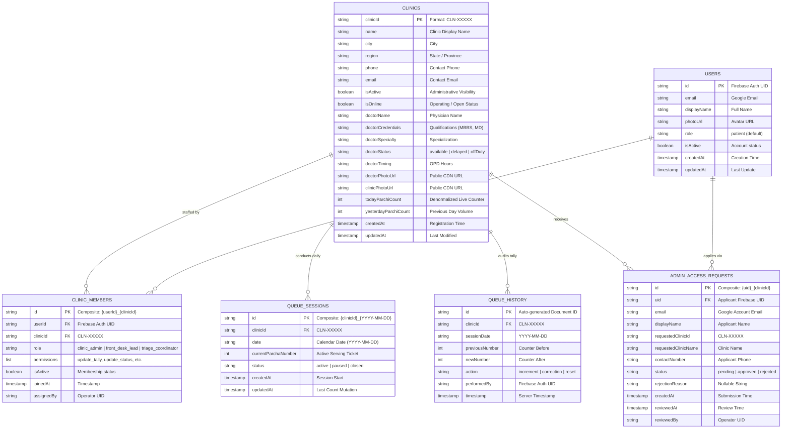

# SYSTEM-DESIGN.md — EasyCheck Online System Design Specification

> **Application:** EasyCheck Online (`easycheck-online`)  
> **Audience:** Senior Software Engineers, Cloud Architects, and Security Auditors  
> **Document Version:** 1.0.0  
> **Last Updated:** 2026-11-12  

---

## 1. System Requirements & Goals

### 1.1 Functional Requirements
- **FR-1 (Real-time Parchi Tracking):** Patients must observe live ticket counts within 1 second of staff updates.
- **FR-2 (Clinic Discovery):** Search clinics by name, doctor name, city, address, or medical specialty.
- **FR-3 (Doctor Availability Management):** Staff must be able to toggle doctor states (`available`, `delayed`, `offDuty`) and OPD timing descriptions.
- **FR-4 (Staff Onboarding & Access Control):** Doctors/staff request access via the app; access is granted only by administrative review via the trusted CLI.
- **FR-5 (Audit Trail):** Every queue increment, decrement, reset, and correction must record an immutable audit history with user attribution.
- **FR-6 (Bilingual Support):** Real-time language switching between English and Hindi with persisted user preference.

### 1.2 Non-Functional Requirements
- **NFR-1 (Low Latency):** Sub-second snapshot propagation for active queue sessions.
- **NFR-2 (Fault Tolerance):** UI must function gracefully in offline/intermittent connectivity without crashing or losing uncommitted increments.
- **NFR-3 (Strict Security):** Zero client trust. All mutations verified server-side via Firestore Security Rules v2.
- **NFR-4 (Cost Efficiency):** Read denormalization on clinic documents to avoid high-volume nested joins.

---

## 2. Data Modeling & Firestore Schema Design

### 2.1 Entity Relationship Diagram



### 2.2 Denormalization Strategy
In Firestore, cross-collection joins (`JOIN`) are unsupported. To ensure patient discovery is instantaneous and costs are minimized:
1. `todayParchiCount` is mirrored directly on the `clinics` document, allowing the home feed to display all clinic counters in a single collection query (`col.snapshots()`).
2. High-frequency live operational updates target `queue_sessions/{clinicId}_{date}`, where individual clinic dashboards listen without triggering multi-document reads across the platform.

---

## 3. Concurrency Control & State Synchronization

### 3.1 Transactional Isolation for Counter Mutations
To avoid lost increments when multiple staff members or devices tap "+1" simultaneously:
- **ACID Transactions:** Every increment, decrement, and reset runs inside `fs.runTransaction<int>()`.
- **Optimistic Concurrency Control (OCC):** Firestore validates that the document has not changed between the transaction's read and write phases. If a conflict occurs, Firestore automatically retries the transaction.

```dart
// Atomic Transaction pattern from QueueRepository
return await fs.runTransaction<int>((transaction) async {
  final sessionDoc = await transaction.get(sessionRef);
  final session = QueueSessionModel.fromDocument(sessionDoc.data()!, sessionDoc.id);
  
  if (session.status != 'active') {
    throw const ServerFailure('Queue session is not active');
  }

  final newNumber = session.currentParchaNumber + 1;
  transaction.update(sessionRef, {
    'currentParchaNumber': newNumber,
    'updatedAt': FieldValue.serverTimestamp(),
  });

  // Dual-write: write audit log in the same atomic commit
  transaction.set(historyRef, {
    'clinicId': clinicId,
    'sessionDate': date,
    'previousNumber': session.currentParchaNumber,
    'newNumber': newNumber,
    'action': 'increment',
    'performedBy': performedBy,
    'timestamp': FieldValue.serverTimestamp(),
  });

  return newNumber;
});
```

---

## 4. Scalability & Performance Engineering

### 4.1 Read/Write Distribution
- **Writes:** Queue increments write to a single document (`queue_sessions/{clinicId}_{date}`). At peak OPD hours, a single clinic issues at most 1–2 tickets per minute, well below Firestore’s sustained limit of 10,000 writes/second per database.
- **Reads:** Firestore client SDK automatically maintains an in-memory and IndexedDB local cache. Subsequent reads within the same session are served from local cache with zero latency.
- **Snapshot Listeners:** WebSockets push byte deltas rather than re-downloading entire collections, minimizing bandwidth consumption on mobile networks.

### 4.2 Query Optimization & Indexes
`firestore.indexes.json` explicitly defines compound query indexes:
- `clinic_members`: `clinicId ASC, isActive ASC` (Fast member listings for admin staff management).
- `queue_history`: `clinicId ASC, sessionDate ASC, timestamp DESC` (Instant historical audit logs).
- `admin_access_requests`: `status ASC, createdAt DESC` (Optimized CLI triaging).

---

## 5. Fault Tolerance & Offline Resilience

1. **Client-Side Resilience:**
   - Flutter's `FirebaseFirestore` SDK includes built-in offline persistence. If a clinic's Wi-Fi briefly drops, local writes are queued in SQLite/IndexedDB and automatically pushed to the cloud upon reconnection.
2. **Graceful Fail-Closed Authorization:**
   - If Firebase or network services are completely unreachable during login, `AuthGateScreen` fails closed. Privileged dashboards are never displayed on unverified cached credentials.
3. **App Check Protection:**
   - Unregistered third-party bots or unauthorized HTTP scrapers are blocked at the Google API gateway before executing queries against Firestore.

---

## 6. Observability, Telemetry & Auditability

1. **Crash Telemetry:** Firebase Crashlytics records all fatal errors and unhandled exceptions with native stack traces and device telemetry.
2. **Immutable Clinical History:** `queue_history` records every counter mutation permanently. Even if a tally is reset to zero, the previous counter and the operator UID are permanently preserved.
3. **Administrative Audit Log:** Every action executed via `tools/admin_cli/index.js` (`create-clinic`, `deactivate-clinic`, `approve`, `remove-member`) writes an atomic entry into `admin_audit_log` with before-and-after snapshots and mandatory reasons.
